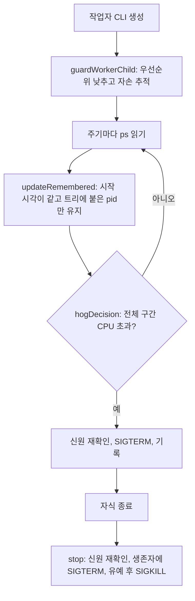

<div align="center">


# pi-process-tree

[English](README.md) · TypeScript · 의존성 없음

[](https://github.com/elfenomenokim/pi-process-tree/blob/main/LICENSE)

[설치](#설치) · [빠르게 써 보기](#빠르게-써-보기) · [필요한 이유](#필요한-이유)

</div>

<p align="center">
  <picture>
    <source media="(prefers-color-scheme: dark)" srcset="https://raw.githubusercontent.com/elfenomenokim/pi-process-tree/main/docs/diagrams/reuse.ko.dark.svg">
    
  </picture>
</p>

**자식 프로세스를 끝까지 책임지되, 엉뚱한 프로세스는 절대 건드리지 않는 TypeScript 라이브러리입니다.** 에이전트나 작업 실행기가 띄운 명령은 또 다른 프로그램을 띄우고, 그 손자 프로세스들이 남아 CPU를 계속 쓰곤 합니다. 그렇다고 PID만 기억했다가 지우면, 그사이 같은 번호를 받은 편집기 같은 다른 프로그램을 죽일 수 있습니다.

- **트리 전체 추적:** 루트가 띄운 자식과 손자를 모두 "PID + 시작 시각"으로 기억합니다.
- **신호 전에 재확인:** 신호를 보내기 직전 `ps`를 다시 읽어, 시작 시각이 그대로인 프로세스에만 보냅니다.
- **폭주 정리:** 정해 둔 시간 내내 CPU를 넘게 쓴 자손은 먼저 SIGTERM으로 끝내라고 하고, 유예 뒤에도 남으면 SIGKILL합니다. 루트 자체에는 절대 신호를 보내지 않습니다.

의존성이 없습니다. macOS와 Linux를 지원하고, Windows는 아직 지원하지 않습니다.

## 설치

```sh
npm install github:elfenomenokim/pi-process-tree
```

```js
import { trackDescendants } from "pi-process-tree";
```

파일 하나만 복사해도 됩니다. `git clone https://github.com/elfenomenokim/pi-process-tree`로 받은 뒤
`process-tree.ts`(TypeScript)나 `process-tree.js`(일반 JavaScript)를 가져가세요.

Node 22.18 이상이 필요합니다(타입을 네이티브로 벗깁니다). 의존성은 없습니다.
macOS(Apple Silicon), Node 22.23.5에서 확인했습니다.

## 빠르게 써 보기

```console
$ node docs/demo/track.mjs
parsed=3 descendantsOf([101])=202,303
hog: stop=[] (streak just started)
live: root=99191 grandchild-reaped=1 root-alive-after-stop=true
```

앞 두 줄은 `ps` 한 샘플에 대한 순수 함수 결과입니다. 세 행을 읽고 자손 둘을
찾았고, 폭주 streak이 막 시작돼 멈춘 것은 없습니다. 마지막 줄은 실측입니다.
실제 자식이 분리된 손자를 낳았고, `stop()`이 손자를 거두고(`grandchild-reaped=1`)
루트는 살려 둡니다.

```js
import { guardWorkerChild } from './process-tree.ts';

const guard = guardWorkerChild(child.pid, (line) => notes.push(line));
// ... 자식이 어떤 이유로든 끝나면:
const stopped = await guard.stop(); // 실제로 시그널이 닿은 pid
```



그림 원본은 `docs/diagrams/track.ko.mmd`입니다.

## 필요한 이유

이 일의 절반씩은 맡는 도구가 둘 있습니다.
[ps-tree](https://github.com/indexzero/ps-tree)는 자손을 나열만 하고 죽이는 건
호출자 몫입니다(자체 README의 예제도 `kill -9`). pid가 같은 프로세스인지
확인하지 않습니다. [tree-kill](https://github.com/puma/tree-kill)은 루트까지
포함해 트리를 죽이지만 역시 신원 확인이 없습니다. 둘 다 폭주 규칙이 없습니다.

`pi-process-tree`는 프로세스 그룹 밖에 손자를 두는 작업자 CLI에 필요했던
엄격한 절반입니다. 시그널 앞에는 항상 새 `ps` 읽기와 (pid, 시작 시각) 신원
확인이 있고, 고아 입양을 충돌로 오판하지 않으며, 창구간 내내 CPU 한계를 넘긴
폭주에 SIGTERM 한 번과 영수증 한 줄을 남기고, `stop()`은 SIGTERM 후 유예
뒤 SIGKILL을 보내면서 루트, pid 0·1, 자신, 부모에는 절대 보내지 않습니다.

## 참고

| 내보내기 | 용도 |
|---|---|
| `trackDescendants(rootPid, opts)` | `ps`를 주기적으로 읽고 자손을 추적하며 폭주를 거둡니다. `{ stop() }` 반환 |
| `guardWorkerChild(pid, onNote?)` | 자식 우선순위를 낮춘 뒤 `trackDescendants` |
| `parsePs(output)` | `ps -A -o pid=,ppid=,pcpu=,lstart=` 행 읽기 |
| `descendantsOf(rows, seeds)` | 시드의 모든 자손. 시드 제외 |
| `updateRemembered(remembered, rows, rootPid, rootStart)` | 한 샘플 뒤의 기억 맵 |
| `signalTargets(remembered, current, rootPid)` | (pid, 시작) 신원이 그대로인 pid |
| `hogDecision(hot, rows, now, {...})` | 다음 hot 맵과 지금 멈출 pid |
| `reopenHogs(hot, pids)` | 시그널이 닿지 않은 pid의 stopped 표시 지우기 |
| `hogLimits()` | `PI_WORKER_HOG_*`에서 읽은 `{ cpu, seconds }`와 기본값 |
| `runawayNote(pid, cpu, seconds)` | 멈춘 폭주 한 건의 영수증 문구 |
| `withNotes(stderr, notes)` | 분류 대상 stderr를 더럽히지 않고 추적 메모 붙이기 |
| `lowerPriority(pid?)` | 생성 직후 자식의 스케줄 우선순위 낮추기 |

| 옵션·변수 | 기본값 | 용도 |
|---|---|---|
| `intervalMs` | `3000` | 샘플 주기 |
| `killGraceMs` | `3000` | `stop()`의 SIGTERM→SIGKILL 유예 |
| `retryMs` | `500` | 신호 전 읽기 실패 시 한 번 재시도 대기 |
| `hogCpu` / `PI_WORKER_HOG_CPU` | `150` | 폭주 streak 시작 CPU(%) |
| `hogSeconds` / `PI_WORKER_HOG_SECONDS` | `300` | 멈추는 streak 길이(초) |
| `PI_WORKER_NICE` | `10` | 자식에 거는 nice. `0`이면 끔 |

## 한계

- macOS·Linux 전용입니다. `/bin/ps -A -o pid=,ppid=,pcpu=,lstart=`를 읽습니다.
  Windows에서는 아무것도 멈추지 않는 no-op입니다.
- 폴링입니다. 두 샘플 사이에 났다 끝난 자손, 첫 샘플 전 부모가 끝난 자손은
  보지 못합니다.
- `lstart` 해상도는 1초라 신원은 (pid, 시작 시각)에 트리 귀속을 더한 것입니다.
  시각 하나만으로 증명하지 않습니다.
- `ps` 읽기 실패는 아무것도 바꾸지 않습니다. 사라짐으로 읽지 않습니다.
  `ps`·`kill` 실패는 전부 삼킵니다.
- 폭주 streak은 간격 세 개 이내의 연속 샘플로만 잇습니다. 멈춘 호스트가
  쌓아서 멈추는 일은 없습니다.

## 기여

이슈와 풀 리퀘스트를 환영합니다. 확인할 점은
[CONTRIBUTING.md](CONTRIBUTING.md)에 있습니다. 테스트를 돌리고 결과를 보여
주세요.

## 라이선스

MIT. [LICENSE](LICENSE)를 보세요.
