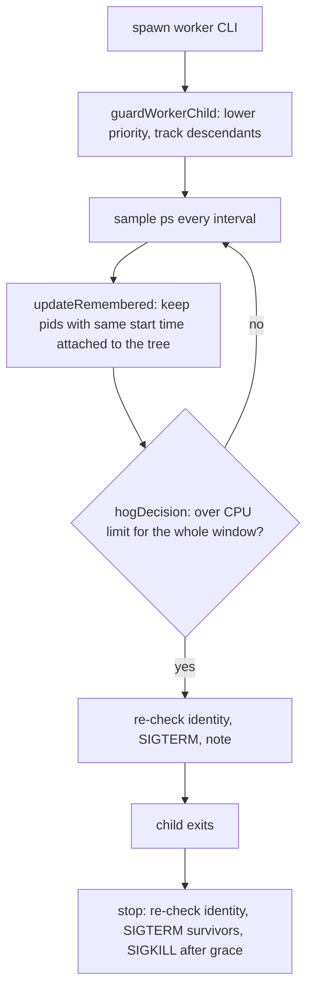

<div align="center">


# pi-process-tree

[한국어](README.ko.md) · TypeScript · Zero dependencies

[](https://github.com/elfenomenokim/pi-process-tree/blob/main/LICENSE)

[Install](#install) · [Quick start](#quick-start) · [Why](#why)

</div>

<p align="center">
  <picture>
    <source media="(prefers-color-scheme: dark)" srcset="https://raw.githubusercontent.com/elfenomenokim/pi-process-tree/main/docs/diagrams/reuse.dark.svg">
    
  </picture>
</p>

**A TypeScript library that owns every process your child spawns, and never touches one it did not spawn.** A command started by an agent or a job runner starts other programs, and those grandchildren keep burning CPU after the run. Remembering only the PID is not safe: by the time you kill it, the OS may have given that number to your editor.

- **Track the whole tree:** every child and grandchild of the root is remembered by PID plus start time.
- **Re-check before any signal:** `ps` is read again right before signalling, and only processes with the same start time are touched.
- **Reap runaways:** a descendant over the CPU limit for the whole window gets SIGTERM, then SIGKILL after a grace period. The root itself is never signalled.

Zero dependencies. macOS and Linux; Windows is not supported yet.

## Install

```sh
npm install github:elfenomenokim/pi-process-tree
```

```js
import { trackDescendants } from "pi-process-tree";
```

Or copy the single file: `git clone https://github.com/elfenomenokim/pi-process-tree` and take
`process-tree.ts` (TypeScript) or `process-tree.js` (plain JavaScript).

Node 22.18 or newer is required (it strips the types natively). No dependencies.
Tested on macOS (Apple Silicon) with Node 22.23.5.

## Quick start

```console
$ node docs/demo/track.mjs
parsed=3 descendantsOf([101])=202,303
hog: stop=[] (streak just started)
live: root=99191 grandchild-reaped=1 root-alive-after-stop=true
```

The first two lines are pure functions on one `ps` sample: three rows parsed,
two descendants found, and a hog streak that just started (nothing stopped yet).
The last line is live: a real child spawned a detached grandchild, `stop()`
reaped the grandchild (`grandchild-reaped=1`), and the root was left running.

```js
import { guardWorkerChild } from './process-tree.ts';

const guard = guardWorkerChild(child.pid, (line) => notes.push(line));
// ... when the child exits, for any reason:
const stopped = await guard.stop(); // pids actually signalled
```



The diagram source is `docs/diagrams/track.mmd`.

## Why

Two established tools cover half of this. [ps-tree](https://github.com/indexzero/ps-tree)
lists descendants but leaves the killing to the caller (`kill -9` in its own
README) with no check that a pid still belongs to the same process.
[tree-kill](https://github.com/puma/tree-kill) kills the tree including the
root, again with no identity check. Neither has a runaway rule.

`pi-process-tree` is the stricter half we needed for worker CLIs that fork
grandchildren outside their own process group: every signal is preceded by a
fresh `ps` read and a (pid, start time) identity check, orphan adoption is
handled instead of mistaken for a collision, a hog that stays over the CPU
limit for the whole window gets one SIGTERM with a receipt line, and `stop()`
sends SIGTERM then SIGKILL after a grace period without ever signalling the
root, pid 0, pid 1, itself or its parent.

## Reference

| Export | Purpose |
|---|---|
| `trackDescendants(rootPid, opts)` | Poll `ps`, track descendants, reap hogs; returns `{ stop() }` |
| `guardWorkerChild(pid, onNote?)` | Lower the child's priority, then `trackDescendants` |
| `parsePs(output)` | Parse `ps -A -o pid=,ppid=,pcpu=,lstart=` rows |
| `descendantsOf(rows, seeds)` | Every transitive child of the seeds, seeds excluded |
| `updateRemembered(remembered, rows, rootPid, rootStart)` | Next remembered map after one sample |
| `signalTargets(remembered, current, rootPid)` | Pids whose (pid, start) identity still matches |
| `hogDecision(hot, rows, now, { rootPid, cpu, seconds, maxGapMs? })` | Next hot map plus pids to stop now |
| `reopenHogs(hot, pids)` | Clear the stopped mark of pids a signal did not reach |
| `hogLimits()` | `{ cpu, seconds }` from `PI_WORKER_HOG_*`, with defaults |
| `runawayNote(pid, cpu, seconds)` | The receipt line for one stopped runaway |
| `withNotes(stderr, notes)` | Append tracker notes without polluting classified stderr |
| `lowerPriority(pid?)` | Lower the child's scheduling priority after spawn |

| Option / variable | Default | Purpose |
|---|---|---|
| `intervalMs` | `3000` | Sampling period |
| `killGraceMs` | `3000` | SIGTERM to SIGKILL wait in `stop()` |
| `retryMs` | `500` | Wait before the single retry of a failed pre-signal read |
| `hogCpu` / `PI_WORKER_HOG_CPU` | `150` | Percent CPU that starts a hog streak |
| `hogSeconds` / `PI_WORKER_HOG_SECONDS` | `300` | Streak length that stops a hog |
| `PI_WORKER_NICE` | `10` | `nice` applied to the child; `0` disables |

## Limits

- macOS and Linux only: it reads `/bin/ps -A -o pid=,ppid=,pcpu=,lstart=`. On
  Windows every call is a no-op that stops nothing.
- Sampling is a poll: a descendant that starts and ends between two samples is
  never seen, and neither is one whose parent exited before the first sample.
- `lstart` has one-second resolution, so identity is (pid, start time) plus
  attachment to the tracked tree, not the timestamp alone.
- A failed `ps` read changes nothing: it is never read as "disappeared".
  Every `ps` or `kill` failure is swallowed.
- A hog streak is made of samples no more than three intervals apart, so a
  suspended host cannot accumulate into a stop.

## Contributing

Issues and pull requests are welcome. See [CONTRIBUTING.md](CONTRIBUTING.md) for
the check that matters: run the suite and show its result.

## License

MIT. See [LICENSE](LICENSE).
